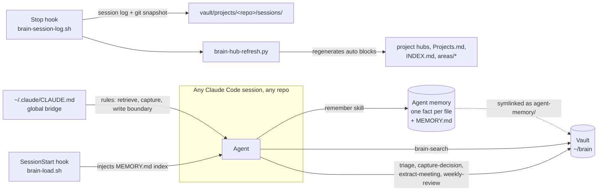

<div align="center">

# Brain

**One central memory that every AI coding session, in every repo, reads from and writes to.**

</div>

I built this so that nothing I tell an agent in one project is lost to the next. Every
Claude Code session I open, in any repository, starts out knowing my preferences, my
active projects, and the decisions I have already made. It also leaves a record of what
it did behind it. Without this, every session starts from zero and I end up repeating
myself.

It is a plain-markdown Obsidian vault, a short global instruction file, two hooks, a
search wrapper, and a set of skills. There is no server and no database. Everything is
files you can read, grep, and version.

This repo is the system without the content: the tooling, the templates, the rules, and a
small fictional example vault. Clone it, point it at your own folder, and you have the
same setup.

---

## The idea

### One brain, every session

Most agent memory is scoped to one project. That is the wrong shape for a person. My
preferences, the people I work with, and how I like code verified are the same in every
repo. So there is one brain, and a global bridge file (`~/.claude/CLAUDE.md`) connects
every session back to it, wherever the session starts.

### Two stores, two jobs

| | Agent memory | The vault |
|---|---|---|
| What | Small, curated facts: preferences, operating rules, active projects, vision | Long-term knowledge: notes, decisions, meetings, clippings, references, project logs |
| Shape | One fact per file plus a one-line-per-fact `MEMORY.md` index | Obsidian markdown with frontmatter and `[[links]]` |
| How it is read | Injected into **every** session at start by a hook | Full-text searched on demand with `brain-search` |
| Scale | Hundreds of lines, kept tight | Years of notes |
| Lives at | `~/.claude/projects/<vault-path>/memory/` (mirrored into the vault as `agent-memory/`) | `~/brain` (or wherever you put it) |

The working set is always in context and costs almost nothing. The long tail is one
search away. "What stack do I default to?" comes from memory. "What did we decide about
pricing three months ago?" comes from the vault.

### You write the vault. The agent reads, suggests, and executes.

This is the rule that keeps the whole thing honest. The notes in the vault are my
thinking, and the agent never writes its own conclusions into them. Anything it
generates (plans, drafts, analysis) goes to `_generated/` or back into chat. The only
places it may write are agent memory, `_generated/`, and filing into `sources/` (meeting
extractions, clippings) or a project's session log.

Why: the point of a second brain is to see your own patterns. If the agent's past output
gets mixed into your notes, every later "pattern" it finds is partly its own echo.

### Capture rules

- **Capture proactively.** When a session establishes something durable (a preference, a
  decision about how I work, an ongoing project, a reference I will cite later) the agent
  writes it to the brain without being asked, using the `remember` skill.
- **Route by kind.** Operating facts and preferences go to agent memory. References,
  meetings, and artifacts go to the vault, because that is the searchable store.
- **People get their own note.** A fact about a person goes in `areas/People/<Name>.md`,
  never buried in a session log where nobody will find it by name.
- **Default to the brain.** Never a project-local memory silo, unless it is purely that
  repo's implementation detail.
- **Dedup before writing.** Update the existing memory instead of adding a near-copy.

### The indexing contract

Recall months later depends on this, so it is not optional:

- Every memory has a `name` (kebab slug), a one-line `description:` written with the
  words a future search would use, and a `metadata.type` (`user`, `feedback`, `project`,
  or `reference`).
- The body links related memories with `[[slug]]`.
- Every memory gets exactly one pointer line in `MEMORY.md`, in the same edit. An
  unindexed memory is a lost memory.
- Dates are absolute (`YYYY-MM-DD`), never "last Tuesday".

```markdown
---
name: keep-replies-short
description: reply style preference — answer first, keep replies to a few lines unless I ask for depth
metadata:
  type: feedback
---
Lead with the answer. Keep replies to a few lines unless I ask for a deep dive.

**Why:** long replies bury the one line I needed.
**How to apply:** answer, then at most one line of context.

Related: [[user-prefers-typescript]]
```

---

## How the pieces connect



In plain text:

1. **Session starts.** Claude Code loads `~/.claude/CLAUDE.md` (the bridge) and runs the
   SessionStart hook, which prints `MEMORY.md` into context. The agent now knows what is
   stored and where to look for more.
2. **During the session.** Before acting on anything that might depend on history, the
   agent checks the index, reads the matching memory file, or runs `brain-search`. When
   something durable comes up, it saves it with `remember`.
3. **Session ends.** The Stop hook writes a dated session log for the current repo into
   `projects/<repo>/sessions/YYYY-MM-DD.md` (branch, last commit, uncommitted changes),
   keeps any narrative the agent wrote below that snapshot, then refreshes the hub notes
   and commits just those files to the vault's git repo.

---

## What's in here

```
brain-public/
├── README.md                 this file
├── CLAUDE.md                 vault operating manual: the rule, folder layout, frontmatter
│                             schema, agent_load retrieval levels, Obsidian CLI reference
├── global-CLAUDE.md          template for ~/.claude/CLAUDE.md (the bridge)
├── settings.example.json     hook + env wiring for ~/.claude/settings.json
├── hooks/
│   └── brain-load.sh         SessionStart: injects the MEMORY.md index
├── .claude/
│   ├── bin/brain-search      Obsidian CLI wrapper that fails loudly instead of returning empty
│   ├── hooks/
│   │   ├── brain-session-log.sh   Stop: per-repo session log + auto-commit
│   │   ├── brain-hub-refresh.py   regenerates auto blocks in hubs, Projects.md, INDEX.md, areas
│   │   └── categories.json        which projects and memory slugs belong to each area note
│   ├── commands/
│   │   ├── context.md        /context: load working context and brief me
│   │   └── trace.md          /trace <topic>: how an idea evolved over time
│   └── skills/
│       ├── remember/         capture a fact into agent memory with correct indexing
│       ├── triage/           sort loose captures into typed, filed notes (asks first)
│       ├── capture-decision/ immutable, dated decision records that supersede, never edit
│       ├── extract-meeting/  transcript -> meeting note + action items, faithfully
│       ├── weekly-review/    surface the week's patterns as questions, in chat only
│       ├── init-project/     scaffold a repo and register its hub in the brain
│       └── testing/          proportional, honest verification of any code change
├── templates/                daily, decision, note, person, project (Templater)
└── examples/                 a tiny, entirely fictional vault + agent memory
    ├── vault/
    └── agent-memory/
```

### The vault layout

Flat on purpose. Meaning lives in frontmatter (`type`, `category`, `tags`) and links,
not in deep folders, because fewer filing decisions per note is what keeps the capture
habit alive.

```
~/brain/
├── CLAUDE.md          agent manual
├── INDEX.md           live map, read second every session
├── Projects.md        auto-maintained roster of every project folder
├── *.md               your own notes, distinguished by `type`
├── daily/             YYYY-MM-DD.md
├── areas/<Area>/      hub notes per person or area, with an auto-refreshed block
├── projects/<repo>/   one folder per code repo: hub note + sessions/ + its decisions
├── sources/           meetings/, clippings/ (external material)
├── attachments/       images, audio, PDFs
├── archive/           done and dead, kept for grep
├── agent-memory/      symlink to the agent memory store
├── _generated/        agent output only, safe to delete
├── templates/
└── .claude/           skills, commands, hooks
```

Each note carries an `agent_load` hint (`high`, `medium`, `low`, `never`) that tells the
agent what to pull into context by default. `never` means private: the agent does not
read it unless you point at that exact file.

### Auto blocks

Generated content sits between `<!-- brain:auto:start -->` and `<!-- brain:auto:end -->`.
The refresh script rewrites only what is inside those markers, so it can run on every
session end without touching anything you wrote around them.

---

## Setup

You need [Obsidian](https://obsidian.md) 1.12+ with the CLI enabled, Claude Code,
`python3`, and `git`. The scripts are bash and were written on macOS; they should run on
Linux with the Obsidian app-launch line in `brain-search` being a no-op.

**1. Create your vault.**

```bash
git clone <this-repo> ~/brain
cd ~/brain
rm -rf .git && git init   # start your vault's own history, in a PRIVATE repo
mkdir -p daily projects areas/People sources/meetings sources/clippings attachments archive _generated
```

The shipped `.gitignore` keeps personal content out of git so this public repo stays
clean. In your own private vault, delete its "your own content" block, or the Stop
hook's auto-commit of session logs will have nothing it is allowed to commit.

Open `~/brain` in Obsidian ("Open folder as vault"), enable the CLI in settings, install
the Templater plugin and point it at `templates/`.

**2. Pick your paths.** The scripts read these from the environment:

| Variable | Default | Meaning |
|---|---|---|
| `BRAIN_DIR` | `~/brain` | the vault folder |
| `DEV_DIR` | `~/Developer` | the folder your repos live in; sessions there are logged |
| `BRAIN_VAULT` | `brain` | the Obsidian vault name, for `brain-search` |
| `BRAIN_MEMORY_DIR` | `~/.claude/projects/<BRAIN_DIR with / as ->/memory` | agent memory |
| `BRAIN_AUTO_PUSH` | `0` | `1` makes the Stop hook push the vault after committing |

**3. Create the agent memory store and mirror it into the vault.**

```bash
MEM="$HOME/.claude/projects/$(printf '%s' "$HOME/brain" | sed 's#[^A-Za-z0-9]#-#g')/memory"
mkdir -p "$MEM"
printf '# Memory index\n' > "$MEM/MEMORY.md"   # or start from examples/agent-memory/MEMORY.md
ln -s "$MEM" ~/brain/agent-memory
```

**4. Install the bridge.** Copy `global-CLAUDE.md` to `~/.claude/CLAUDE.md` and replace
the placeholders at the top. If you already have a global `CLAUDE.md`, paste it in as a
section.

**5. Install the hooks.**

```bash
mkdir -p ~/.claude/hooks
cp hooks/brain-load.sh ~/.claude/hooks/
chmod +x ~/.claude/hooks/brain-load.sh ~/brain/.claude/hooks/*.sh ~/brain/.claude/hooks/*.py ~/brain/.claude/bin/brain-search
```

Then merge `settings.example.json` into `~/.claude/settings.json` with your real
absolute paths. To exclude a repo from logging, put an empty `.no-brain-log` file in it.

**6. Put the search wrapper on your PATH.**

```bash
mkdir -p ~/.local/bin
ln -s ~/brain/.claude/bin/brain-search ~/.local/bin/brain-search
brain-search "anything"   # exit 0 = searched, 3 = Obsidian not serving the vault
```

**7. Make the skills global.**

```bash
mkdir -p ~/.claude/skills
for s in ~/brain/.claude/skills/*/; do ln -s "$s" ~/.claude/skills/; done
git clone https://github.com/kepano/obsidian-skills ~/brain/.claude/skills/obsidian-skills
```

**8. Define your areas.** Edit `.claude/hooks/categories.json`: each key is a note under
`areas/` (for example `People/Alex Example`), with the project folders and memory-slug
regexes that belong to it. Create the matching notes; the hook fills their auto blocks.

**9. Try it.** Open Claude Code in any repo under `DEV_DIR`. The session should open
with your memory index in context. Tell it a preference and watch it land in agent
memory. End the session and look in `~/brain/projects/<repo>/sessions/`.

---

## Rhythm

- **Daily:** capture into today's note or a quick root note. Tag, link, move on.
- **Weekly:** `/triage`, then `/weekly-review`.
- **Always:** let the agent capture as you go. Don't over-file; the habit of capturing
  beats any filing scheme.

## Example

`examples/` is a fictional vault with one project (`acme-widget`), one daily note, one
decision, one person (Alex Example), an area hub, and an agent memory store with four
memories and their index. None of it is real. It exists to show the formats exactly as
the hooks produce and read them.

## Credits

- [kepano](https://github.com/kepano) for the flat, root-heavy vault conventions and the
  official [obsidian-skills](https://github.com/kepano/obsidian-skills).
- The "vault as personal OS" workflow popularized by InternetVin and Greg Isenberg.
- The PARA method, adapted here into storage buckets rather than meaning.
